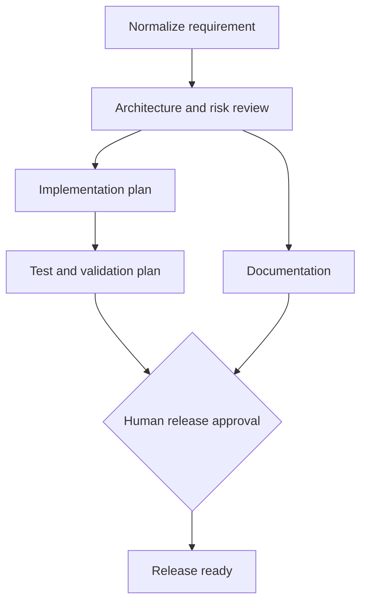

# Architecture Notes

## Service boundaries
- **url-service:** owns short-code lifecycle and redirects.
- **analytics-service:** owns click events and query projections.
- **orchestrator-service:** owns requirement intake, dependency graph, execution state, gates and audit history.
- **PostgreSQL:** separate logical databases (`urls`, `analytics`) for service ownership.

## Workflow graph

## Key decisions and trade-offs
- Deterministic agents keep the prototype reproducible and runnable without paid API keys.
- Parallel-ready DAG branches are represented explicitly; the current executor evaluates all ready tasks in one pass. A production executor should use a durable queue and concurrency limits.
- Approval is enforced by a server-side state transition, not a prompt instruction.
- The implementation plan is an artifact only: this prototype deliberately does not modify repositories, run arbitrary generated code, or deploy infrastructure.
- Database schema auto-update is convenient for demos; use versioned migrations for production.
